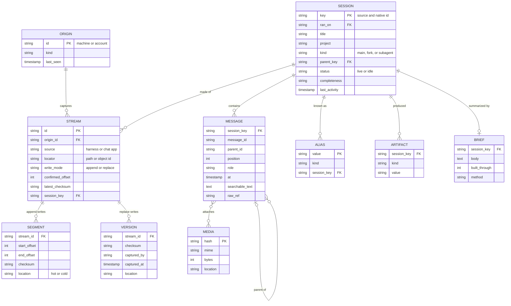

# 0002. Data model

- Status: Accepted
- Date: 2026-10-23

## Context

[Decision 0001](0001-central-session-store.md) sets the architecture. Every part of it reads or writes the same records, so the records come before the code.

The sources store sessions in different ways:

- Claude Code appends to one JSONL file per session. Subagents get their own JSONL files, and large tool outputs are saved as separate files.
- Codex appends to one JSONL file per thread and numbers every line with an `ordinal`. It compresses finished files. Its reasoning items are encrypted.
- Grok keeps one folder per session. The folder holds an `updates.jsonl` file that only grows, and JSON files such as `summary.json` that Grok rewrites in place.
- T3 Code keeps its threads in a SQLite database, together with a table that maps each thread to the session of the harness that ran it.
- ChatGPT and claude.ai deliver whole conversations as JSON, from the browser extension or from an account export. A conversation branches when the user edits a message or regenerates a reply.

## Decision

The data model has two layers. The raw layer keeps exactly what arrived and is the source of truth. The session layer is what queries use. The indexer can rebuild the session layer from the raw layer at any time, for example after a parser improves.

### Raw layer

Intake is the only writer of the raw layer.

| Record | What it is | Rules |
| --- | --- | --- |
| Origin | A machine, or a web account | An origin writes only to its own streams. |
| Stream | One raw object that changes over time, such as a transcript file, a rewritten JSON file, one T3 Code thread, or one web conversation | `write_mode` is `append` or `replace`. An append stream tracks `confirmed_offset`. A replace stream tracks `latest_checksum`. One session can have several streams. |
| Segment | One appended byte range of an append stream | A segment never changes. It is unique by stream and start offset. |
| Version | One whole copy of a replace stream | A version never changes. It is unique by stream and checksum. |

`write_mode` is the only place where sources differ in the raw layer. Intake has no code for a specific harness.

### Session layer

The indexer is the only writer of the session layer.

| Record | What it is | Rules |
| --- | --- | --- |
| Session | One conversation | The key is the source and the native ID, such as `claude-code/<uuid>`. `ran_on` records the origin where the session ran. |
| Message | One turn from the user, the assistant, a tool call, a tool result, or the system | Messages form a tree through `parent_id`. `position` orders the current branch. `searchable_text` has secrets removed and long tool output shortened. `raw_ref` points to the exact bytes in a segment or a version. |
| Alias | Any other ID that leads to a session | An alias value is unique. Aliases include native IDs, Claude desktop `local_` IDs, T3 Code thread IDs, and URLs. Titles are not aliases, because titles are not unique. |
| Artifact | Something a session produced | Kinds include published artifacts, pull requests, commits, and changed files. |
| Brief | The default answer for a session | `built_through` is the last message position that the brief covers. A brief is stale when the session has newer messages. |
| Media | An image or a file that a message refers to | The key is a hash of the content, so a file that appears many times is stored once. |

### Session identity

Every source that Prime Radiant reads uses globally unique session IDs, such as UUIDs and web conversation IDs. So a session is identified by its source and its native ID. The origin where the session ran is an attribute, not part of the key. When the same session reaches the hub from two machines, for example a remote session that a desktop app also copies locally, the second copy is one more stream of the same session.

### Writers and readers

| Records | Writer | Readers |
| --- | --- | --- |
| Origin, stream, segment, version | Intake | Indexer, query, archiver |
| Session, message, alias, artifact, brief, media | Indexer | Query |
| Cold copies of segments and versions | Archiver | Query |

### Lookups

These lookups need indexes:

- An exact alias, for `find` with an ID.
- Full-text search over message text and session titles, for `find` with words.
- Sessions by project, by origin, and by last activity, for filters.
- Messages by session and position, for pages of `read`.
- Streams by origin and locator, so that a collector can resume.

### Merging captures

| Case | Result |
| --- | --- |
| The extension captured a web chat, and an account export of it arrives later | The two versions belong to the same session. The indexer merges messages by native message ID. The session becomes complete when the export arrives. |
| The same export is imported twice | The checksum already exists, so intake stores nothing new. |
| The user edits a message or regenerates a reply | The new version adds sibling messages under the same parent. The source's current-branch marker sets `position`. |

## Consequences

- The indexer can rebuild the session layer from the raw layer at any time.
- Only the indexer knows source formats. It has one parser per source.
- The T3 Code collector is the one collector that reads a format. It reads the database and writes one replace stream per thread, because copying the whole database after every change is too heavy.
- Codex reasoning is stored but not searchable, because it is encrypted.
- A retried segment or a repeated import changes nothing, because of the uniqueness rules on segments and versions.

## Defaults

These defaults can change without changing the model:

- Searchable text has secrets removed and long tool output shortened. The raw layer keeps everything exactly.
- The indexer rebuilds a brief when its session goes idle.
