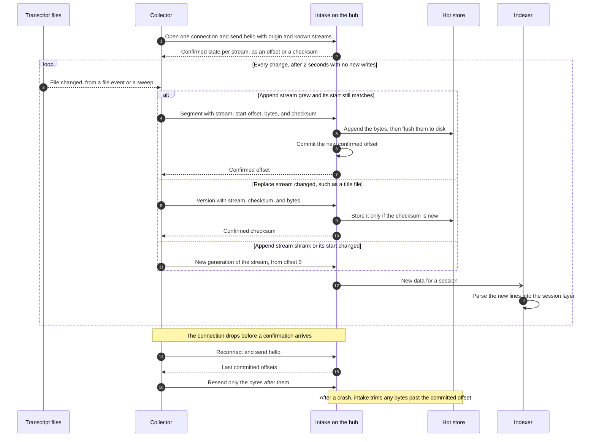
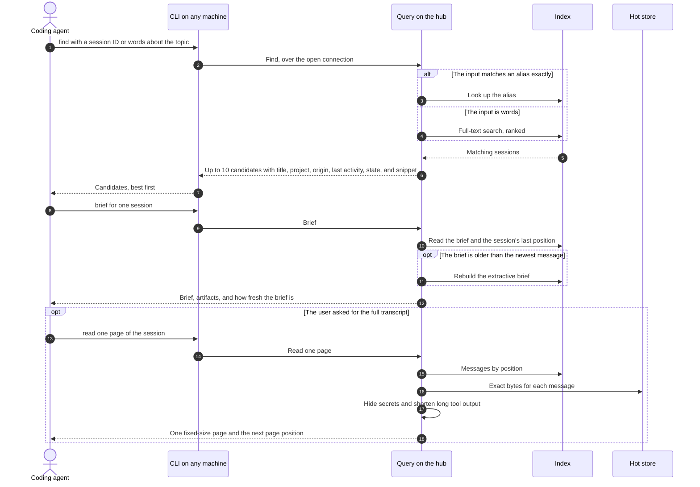

# 0003. Thin slice

- Status: Accepted
- Date: 2026-10-23

## Context

[Decision 0001](0001-central-session-store.md) sets the architecture, and [decision 0002](0002-data-model.md) sets the data model. The first code must prove the whole loop, from a transcript on one machine to an answer for a coding agent on another, before more sources are added. Each step must end in a check that passes before the next step starts.

## Decision

### Scope

The first slice covers Claude Code only. Claude Code puts the session ID in each file name, and it uses both write modes of the raw layer: transcripts only grow, and small files such as `custom-title.json` and subagent `.meta.json` files are rewritten in place.

| In the slice | Left for later milestones |
| --- | --- |
| Claude Code transcripts, subagent transcripts, `tool-results/`, title and metadata files | Codex, T3 Code, Grok |
| The raw layer and the session layer from decision 0002 | Web chat extension, account export import |
| `find`, `brief`, `read`, and `grep` through a CLI and a skill | MCP server, prompt hook, T3 Code picker |
| A collector with file watching, a sweep, one open connection, and resume from confirmed offsets | Archiver, cold archive, encryption |
| Extractive briefs, keyword search, and secrets hidden on read | Briefs that an LLM writes, semantic search, media deduplication |

### Units

| Unit | Builds | Check |
| --- | --- | --- |
| 1. Local loop | Reads Claude Code files on one machine into the raw layer, indexes them, and answers `find` and `brief` | Every session ID on the machine resolves. Ten chosen topics each find the right session in the top 3. A second import changes no count and no checksum. |
| 2. Across machines | A collector on one machine, intake and the index on the hub, one open connection, and resume from confirmed offsets | Every stream on the hub matches its source byte for byte. A killed collector or a dropped network still ends with identical copies and no duplicates. A new line in a running session is findable on the hub within 5 seconds. |
| 3. Agents use it | The CLI on any machine querying the hub, `read` and `grep` pages, the skill for each harness, and secrets hidden on read | A fresh coding agent on another machine, given only a session ID, answers correctly in 3 commands or fewer and in under 60 seconds. The same holds for a topic. |

Unit 1 is useful on its own, because it already searches every Claude Code session on one machine.

### Delivery order

Each pull request ends in its own check:

1. The project skeleton and a test setup with made-up example transcripts. Tests never use real sessions, because this repository is public.
2. The raw layer.
3. The Claude Code parser and the session layer.
4. `find` and `brief`.
5. The collector and intake over the connection.
6. `read`, `grep`, and the skill.

### Language and runtime

Prime Radiant is written in Rust.

- One binary per machine. The hub runs a binary and needs no runtime or toolchain.
- File watching uses each operating system's own interface: FSEvents on macOS and inotify on Linux.
- Every CLI call starts fast, which matters because a coding agent runs the CLI for each question.
- Rust is slower to write and change than the alternatives below. That is the main cost.

These libraries are proposals, to verify in the first pull request:

- `notify` for file watching.
- `rusqlite` with its bundled SQLite build for the index, if that build includes full-text search.
- The system `ssh` program for the connection, so that existing keys and settings keep working.

Continuous integration builds the release binaries for macOS and Linux.

| Alternative | Why not |
| --- | --- |
| TypeScript on Bun | Faster to write, with SQLite full-text search built in. Recursive file watching on Linux was unproven, and the runtime is younger. |
| TypeScript on Node | Harder to ship as one file. SQLite and full-text search need an extra library. |
| Python | Hard to ship as one file, and slower to start for each CLI call. |

### Collector connection and resume

Intake writes and flushes the bytes, then commits the offset, and only then confirms. A crash therefore leaves one of two states. Either the offset was not committed, and the collector resends the bytes. Or extra bytes sit past the committed offset, and intake trims them when it restarts. Both states end the same way on the next connection.

### Find, brief, and read

`find` returns at most 10 candidates and `brief` returns about one page, so a large session never fills the agent's context. Full text arrives only through `read`, one page at a time.

## Consequences

- The slice proves identity, offsets, resume, search, and briefs on real Claude Code data before any other source exists.
- Later sources add a parser and collector rules. Intake does not change.
- A developer machine needs the Rust toolchain. Other machines receive release binaries.
- Test data is made up, so the repository never holds a real session.
